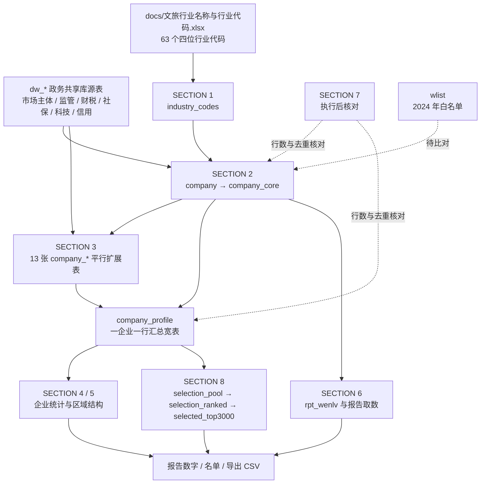

# 宁波市文旅经营主体数据分析项目

## 项目概述

本项目以宁波市政务数据共享库的 `dw_*` 源表为基础，按统一的文旅行业代码口径识别经营主体，扩展企业画像，产出统计与报告取数，并遴选信用质量较好的前 3000 家企业。全链路以统一社会信用代码 `uni_social_crd_cd` 为关联键，分析代码集中在 `src/` 下的两个 SQL 文件。`docs/` 存放依据与参考资料，口径、代码清单、字段名称以这些资料为准。

## 目录结构

```
cultural_companies/
├── README.md                      # 项目说明与代码架构（本文件）
├── columns.md                     # 源表中文名与标准表名对照
├── data/                          # 98 个 dw_* 源表 CSV，本地复现用
├── docs/                          # 依据与参考资料
│   ├── 数据库字段与结构/           # 官方字段字典（xlsx）
│   ├── img/                       # 文档图片
│   ├── comp_type.csv              # 企业类型代码对照
│   ├── 企业状态码值.xlsx
│   ├── 文旅白名单_分县区市_2024.xlsx
│   └── 文旅行业名称与行业代码.xlsx
├── industry_codes/
│   ├── indv_nm.txt                # 63 个四位行业代码
│   └── social_credit_codes.txt    # 信用代码清单
├── report/
│   └── 文旅行业报告_2025-10-16.md # 报告大纲
├── src/
│   ├── culture.sql                # 主分析脚本
│   └── whitelist2024.sql          # 2024 年白名单建表脚本
└── test/
    ├── cul_comp_db.sql            # 本地建库脚本，MySQL 8.0 dump
    ├── local.sql                  # 本地试验查询
    └── test.sql                   # 空文件
```

## 代码架构

### 脚本清单

| 文件                    | 定位                                                               | 建表产出                       | 运行方式                                    |
| ----------------------- | ------------------------------------------------------------------ | ------------------------------ | ------------------------------------------- |
| `src/culture.sql`       | 主分析脚本，覆盖主体筛选、画像扩展、统计、报告取数与 TOP 3000 遴选 | 21 张表，另附各段核对 `SELECT` | MySQL 8.0+ 云端政务数据共享库，分段选中执行 |
| `src/whitelist2024.sql` | 2024 年文旅企业信用白名单，供与主体表按信用代码比对                | `wlist` 1 张表，1430 行        | 同一 MySQL 环境，整文件可重复执行           |

脚本形态是「分段建表 DDL + 可单独执行的校验 `SELECT`」，不是存储过程，也没有调度器。`culture.sql` 每段建表前都有 `DROP TABLE IF EXISTS`，整文件重复执行不会报表已存在。产出物是数据库中间表和查询结果，不直接生成文件；需要导出时使用 `company_profile`、`rpt_wenlv`、`selected_top3000` 三张表。

### 总体数据链路



### `culture.sql` 分节结构

| 分节      | 作用                                                                                               | 主要产出                                                 |
| --------- | -------------------------------------------------------------------------------------------------- | -------------------------------------------------------- |
| SECTION 0 | 执行前检查源表 `comp_type` 与 `indv_nm` 的实际取值形态                                             | 无落表                                                   |
| SECTION 1 | 建行业代码表，写入 63 个四位行业代码，只存代码不存行业名称                                         | `industry_codes`                                         |
| SECTION 2 | 按代码从市场主体总表筛出主体，按信用代码去重留最新一条，再抽核心字段                               | `company`、`company_core`                                |
| SECTION 3 | 逐维度扩展画像，先在源表内预聚合再左连，最后汇总为一张宽表                                         | 13 张 `company_*`、`company_profile`                     |
| SECTION 4 | 全量企业统计，含基础数据、企业家数、经营状况、社保参与、变更活动、信用状况、成立时间分布、行业分布 | 查询结果                                                 |
| SECTION 5 | 区域结构，按住所行政区划与登记机关分别统计                                                         | 查询结果                                                 |
| SECTION 6 | 建统一分析底表，再出报告核心数字、行业覆盖度、企业类型与登记状态分布、社会贡献与信用               | `rpt_wenlv` 与查询结果                                   |
| SECTION 7 | 执行后核对，含各阶段行数、四张表去重企业数一致性、行业覆盖度、扩展表空值抽查                       | 核对结果                                                 |
| SECTION 8 | 信用质量较好企业遴选 TOP 3000，自带删除过程、名单数量、残留与基准日核对                            | `selection_pool`、`selection_ranked`、`selected_top3000` |

### 表清单速查

| 类别     | 表名                                | 说明                                                        |
| -------- | ----------------------------------- | ----------------------------------------------------------- |
| 字典     | `industry_codes`                    | 63 个四位行业代码，全文件筛选企业的唯一代码来源             |
| 主体     | `company`                           | 按代码筛出并去重，一企业一行                                |
| 主体     | `company_core`                      | 10 个核心字段，所有扩展表与统计的共同基准表                 |
| 画像     | `company_fddb` 等 13 张 `company_*` | 一企业一行的平行扩展表，见下表                              |
| 画像汇总 | `company_profile`                   | 把各平行扩展表按信用代码拼成宽表，供 SECTION 4 / 5 / 8 使用 |
| 报告     | `rpt_wenlv`                         | 报告统一分析底表，行数应与 `company` 一致                   |
| 遴选     | `selection_pool`                    | 候选池，逐项打删除标记与时点标记                            |
| 遴选     | `selection_ranked`                  | 通过筛选的企业，给出资产名次与社保名次                      |
| 遴选     | `selected_top3000`                  | 综合名次升序取前 3000 名的最终名单                          |

### SECTION 3 扩展表与源表对照

各扩展表以 `company_core` 为基准平行生成，不是链式累积；每张表先用 `ROW_NUMBER()` 或 `GROUP BY` 在源表内取每家企业的最新一条或计数，再 `LEFT JOIN` 回来，保证一个信用代码只有一行，避免多张一对多表连乘膨胀。次数类字段用 `*_count`，最新值类用 `latest_*`，年报财务字段统一加 `nb_` 前缀。

| 扩展表            | 业务含义                   | 源表                        |
| ----------------- | -------------------------- | --------------------------- |
| `company_fddb`    | 法定代表人                 | `dw_zj_scjdgl_fddbrxx`      |
| `company_jyyc`    | 经营异常名录               | `dw_zj_scjdgl_jyycmlxx`     |
| `company_yzwf`    | 严重违法失信企业名单       | `dw_zj_scjdgl_yzwfsx`       |
| `company_wzwd`    | 企业年报网站或网店         | `dw_nb_scjdgl_qynbwzhwdxx`  |
| `company_nb`      | 企业年报资产               | `dw_nb_scjdgl_qynbzcxx`     |
| `company_ns`      | 纳税                       | `dw_nb_sw_nsxx`             |
| `company_xypj`    | 纳税信用等级（A 级纳税人） | `dw_nb_sw_xypjxxa`          |
| `company_sxr`     | 失信被执行人               | `dw_zj_fzgg_sxbzxrxx`       |
| `company_xzcf`    | 行政处罚                   | `dw_nb_scjdgl_xzcfgsxx`     |
| `company_db`      | 对外担保                   | `dw_nb_scjdgl_dwtgbzdbxx`   |
| `company_sb_jbxx` | 社会保险参保               | `dw_nb_rlsb_sbjylyshbxjbxx` |
| `company_kjzx`    | 科技型小微企业认定         | `dw_nb_kj_sgczkjxzxqy`      |
| `company_cred`    | 公共信用分                 | `dw_nb_dsj_xypjxx`          |

3.16 的 `company_profile` 还左连了 `company_gqbg`（股权变更，源表见 `columns.md` 的 `dw_nb_scjdgl_gqbg`），但脚本中没有这张表的建表语句，详见「已知问题」。

### 关键口径

- **企业范围**：只按 `industry_codes` 中的 63 个行业代码，从市场主体总表 `dw_zj_scjdgl_scztxx` 的 `indv_nm` 字段提取。不叠加经营范围关键词，不区分文化、旅游、文旅融合，全文件只有一套企业范围。`indv_nm` 字段名容易误读为行业名称，当前数据中存放的就是四位行业代码。
- **主体去重**：同一统一社会信用代码只保留最新一条，按 `ROW_NUMBER() OVER (PARTITION BY uni_social_crd_cd ORDER BY appr_dt DESC, est_dt DESC, opt_from DESC)` 取 `rn = 1`，以核准日期 `appr_dt` 为准，成立日期与经营起始日期兜底。`company_core` 不再二次去重。
- **企业类型**：取市场主体总表的 `comp_type` 原值，不设字典表；`docs/comp_type.csv` 可作对照参考，脚本未引用。需要公司制企业、个体工商户等归类时按实际取值另行判断。
- **基准日**：2025-12-31。按年报报送规律，可取得的财务数据为 2025 年度年报的资产总额 `asset_zmt`、营业总收入 `nb_opt_income_total` 等。
- **遴选口径**：行政处罚 `xzcf_count`、严重违法失信 `yzwf_count`、经营异常 `jyyc_count`、失信被执行人 `sxr_count` 任一命中即删除；要求有 2025 年度年报资产数据；企业规模按 `asset_zmt`、社保人数按 `pens_num` 分别取名次，两个名次相加升序取前 3000 名。删除只作用于遴选名单，不回写 `company` 与 `company_core`，因此 SECTION 4 / 5 / 6 保持全量口径。

### 执行顺序与核对

1. 确认云端账号有建表权限；若只允许临时表，把 `CREATE TABLE` 改成 `CREATE TEMPORARY TABLE`。
2. 执行前备份库中已有的 `company_*`、`rpt_wenlv` 表。
3. 按 SECTION 0 → 8 分段选中执行，每段跑完查看结果行数再继续。
4. 取报告数字前跑一遍 SECTION 7；名单取数看 SECTION 8 自带的 8.4—8.7 核对。
5. `src/whitelist2024.sql` 独立执行，建 `wlist` 后再与主体表比对。

### 已知问题与注意事项

1. **`company_gqbg` 未建表**。`company_profile`（3.16）左连该表并取 `gqbg_count`、`latest_gqbg_dt`，SECTION 4 的 4.2 与 4.5 也用到 `gqbg_count`，但 SECTION 3 没有对应的建表语句。执行到 3.16 会报表不存在，需先按 `dw_nb_scjdgl_gqbg` 补建该表，或暂时去掉相关引用。
2. **`opt_strict` 保持注释**。该字段在 `company`、`company_core`、`company_profile`、`rpt_wenlv` 四处都是注释行，启用时需同步下游所有引用。
3. **`test/` 下仅建库脚本可用**。`test/cul_comp_db.sql` 是本地建库脚本；`test/local.sql` 引用 `company_extended`、`wenhua_and_lvyou_company` 等表名，现行 `culture.sql` 不生成这些表；`test/test.sql` 为空文件。
4. **白名单含外部补全数据**。`wlist` 中有 8 个信用代码来自联网查询，不是源 Excel 自带，详见下文章节。
5. **报告大纲取数以脚本为准**。`report/文旅行业报告_2025-10-16.md` 是报告大纲，其中数字与分类口径应按 SECTION 6 的现行取数结果更新。

## 运行环境与数据来源

### 运行环境

- 数据库：MySQL 8.0+，云服务器政务数据共享库；本地复现可用 `test/cul_comp_db.sql` 建库，配 `data/` 下的源表 CSV。
- 字段依据：`docs/数据库字段与结构/金融主题库字段表_20250715.xlsx`，目录页列出标准表名，各编号页列出标准化字段名、类型与样例数据；`columns.md` 提供源表中文名与标准表名对照。
- 表名与字段一律以官方字段字典为准，脚本内两处字段特例见 3.14、3.15。

### 数据来源与参考文件

| 文件                                           | 用途                                        |
| ---------------------------------------------- | ------------------------------------------- |
| `docs/文旅行业名称与行业代码.xlsx`             | 63 个行业代码清单，对应 `industry_codes` 表 |
| `docs/文旅白名单_分县区市_2024.xlsx`           | `wlist` 的数据来源，取 10 张区县明细工作表  |
| `docs/comp_type.csv`、`docs/企业状态码值.xlsx` | 企业类型代码与登记状态码值参考              |
| `docs/数据库字段与结构/`                       | 官方字段字典，含标准表名与字段定义          |
| `industry_codes/indv_nm.txt`                   | 63 个行业代码的纯文本形式                   |
| `industry_codes/social_credit_codes.txt`       | 信用代码清单                                |
| `data/`                                        | 98 个 `dw_*` 源表 CSV，供本地复现与抽样核对 |
| `report/文旅行业报告_2025-10-16.md`            | 报告大纲，对应 SECTION 6 取数               |

## 2024 年文旅企业信用白名单：信用代码补全记录

### 背景

`src/whitelist2024.sql` 依据 `docs/文旅白名单_分县区市_2024.xlsx` 生成，建表为 `wlist`，字段 `comp_nm` 与 `uni_social_crd_cd`，用于和 `src/culture.sql` 中的表按统一社会信用代码比对。源表共有 1439 条明细行，去重后写入 1430 条。

其中 8 家企业的代码列为空或填了占位文字，无法参与按代码比对。这 8 个代码已于 2026-11-06 通过公开渠道联网查询补全并写入 SQL。它们**不是源 Excel 自带数据**，属于需要单独维护的外部补录值；8 个代码均通过 GB 32100—2015 统一社会信用代码校验位验证。

### 补全明细

| 企业名称（保留源表写法）                       | 源表原值               | 补全的统一社会信用代码 | 查询依据                                           | 现名或主体状态                     |
| ---------------------------------------------- | ---------------------- | ---------------------- | -------------------------------------------------- | ---------------------------------- |
| 宁波市文化旅游投资集团有限公司                 | 空                     | `913302003406303832`   | 深圳证券交易所公告，企查查、天眼查                 | 现名宁波文旅会展集团有限公司       |
| 宁波乡遇民宿管理有限公司                       | “无法查询社会信用代码” | `91330205MA2CJ2A712`   | 江北区人民政府“两直”补助名单，企百科、爱企查       | 现名宁波乡遇文化旅游发展有限公司   |
| 宁波云湖酒店管理有限公司                       | “无法查询社会信用代码” | `91330205MA282CGX33`   | 启信宝、企知道、爱企查曾用名记录                   | 现名宁波云隐湖居农庄有限公司       |
| 宁波植物园景区管理有限公司                     | “无法获得社会信用代码” | `91330211MA2828DG4G`   | 百度百科、天眼查                                   | 现名宁波植物园开发建设管理有限公司 |
| 宁波美麟公关策划有限公司                       | “无法获得社会信用代码” | `91330204580535086L`   | 企云库、BOSS 直聘工商信息                          | 现名浙江美昕麟文化传播有限公司     |
| 宁海县心泉房地产开发有限公司                   | “无法获得社会信用代码” | `91330226066604632D`   | 宁波市房产交易信息服务网资质公示，百度百科、企查查 | 现名宁海县心泉旅游发展有限公司     |
| 浙江四季游旅游有限公司                         | 空                     | `91330212MA2GU9CU55`   | 百度百科、爱企查、水滴信用                         | 现名浙江四季游文旅集团有限公司     |
| 宁波奉化阳光新天地餐饮管理有限公司海百桃源宾馆 | 空                     | `913302835874762934`   | 爱企查、企查查、天眼查                             | 分公司，已注销                     |

注：宁波乡遇民宿管理有限公司在另一份政府名单中有 17 位误录值 `91330205MA2CJA721`，未采用。

### 后续特殊处理事项

1. **正式比对前复核**。补全值来自公开渠道，未与国家企业信用信息公示系统逐一核验。对外出具结果前建议复核，或仅在白名单内部比对中使用。
2. **3 家属于旧名与现名重复主体**。源表把同一主体的旧名和现名各记一条，补全后代码一致，已按“同一代码保留首次出现”合并，SQL 中保留的是旧名：
   - 宁波植物园景区管理有限公司与宁波植物园开发建设管理有限公司（`91330211MA2828DG4G`）
   - 宁波美麟公关策划有限公司与浙江美昕麟文化传播有限公司（`91330204580535086L`）
   - 宁海县心泉房地产开发有限公司与宁海县心泉旅游发展有限公司（`91330226066604632D`）

   若后续按企业名称比对，应改用现名或建立别名映射，否则会漏配。

3. **1 家为已注销分公司**。海百桃源宾馆补全的是分公司自身代码，母公司宁波奉化阳光新天地餐饮管理有限公司的代码为 `913302836776661469`，两者不可混用。该分公司登记状态为注销，与 `company` 等表比对时可能匹配不到或状态不一致，需单独判定是否纳入白名单口径。
4. **重新生成会覆盖补全值**。`src/whitelist2024.sql` 为静态文件，生成用的临时脚本已清理。若日后从 Excel 重新生成，源表的空值与占位文字会把这 8 条还原，需按上表重新回填。
5. **关联问题**。名单中另有 5 条代码带前后缀或备注，例如 `已注销91330225MA2900TC1F` 与 `’913302126982475571`。其中内嵌的 18 位片段已通过校验位验证，但尚未清洗，按代码比对时同样匹配不上，需一并处理。

## 项目维护

- 采用 Git 进行版本控制，记录数据模型与口径变更。
- 增减文旅行业只改 `industry_codes` 表的数据，下游筛选自动跟随。
- 字段与口径核对以 `docs/` 下的依据资料为准；行业代码清单变更时同步维护 `industry_codes/indv_nm.txt`。

## 联系方式

如有问题或建议，请联系项目维护团队。

---

_最后更新时间: 2026-11-06_
