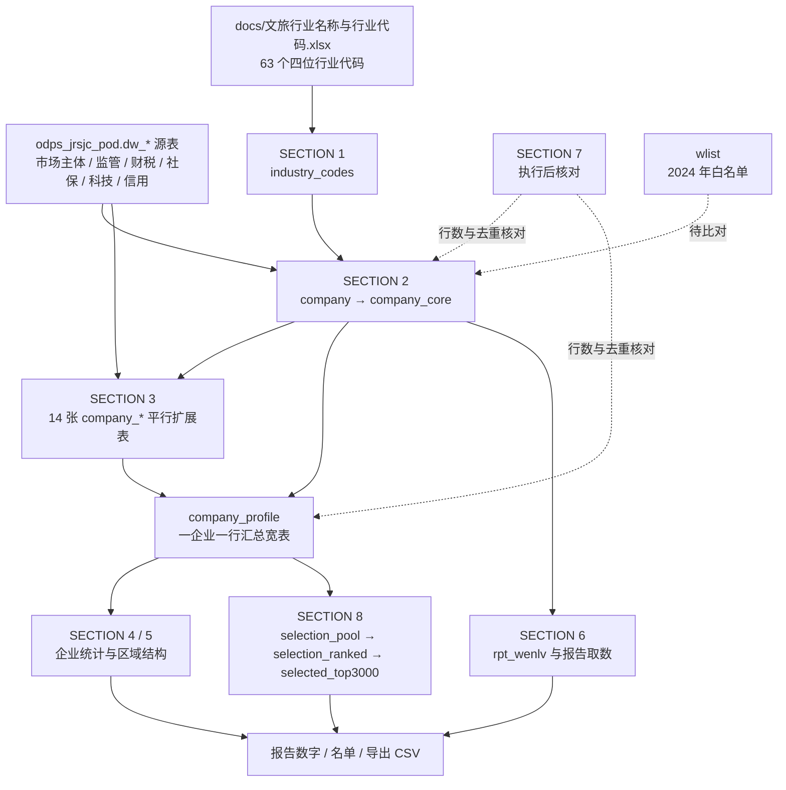

# 宁波市文旅经营主体数据分析项目

## 项目概述

本项目以宁波市政务数据共享库的 `dw_*` 源表为基础，按统一的文旅行业代码口径识别经营主体，扩展企业画像，产出统计与报告取数，并遴选信用质量较好的前 3000 家企业。全链路以统一社会信用代码 `uni_social_crd_cd` 为关联键。云端主脚本为 MaxCompute 方言版 `src/culture_2026.sql`，表存在性检查见 `src/table_exist.sql`，2024 年白名单见 `src/white_list_2024.sql`。`docs/` 存放依据与参考资料，口径、代码清单、字段名称以这些资料为准。

## 目录结构

```
cultural_companies/
├── README.md                      # 项目说明、代码架构与操作思路（本文件）
├── data/                          # 98 个 dw_* 源表 CSV，本地复现用
├── docs/                          # 依据与参考资料
│   ├── img/                       # 文档图片
│   ├── industry_codes/            # 行业代码与信用代码清单
│   ├── 数据库字段与结构/          # 官方字段字典（xlsx）
│   ├── report/                    # 报告大纲
│   ├── 企业状态码值.xlsx
│   ├── 文旅白名单_分县区市_2024.xlsx
│   ├── fields.md                  # 源表中文名、标准表名与字段类型对照
│   └── comp_type.csv              # 企业类型代码对照
├── src/
│   ├── culture_2026.sql           # 云端主分析脚本，MaxCompute 方言
│   ├── white_list_2024.sql        # 2024 年文旅企业信用白名单
│   └── table_exist.sql            # 云端表存在性与年报年度检查
└── test/
    ├── cul_comp_db.sql            # 本地建库脚本，MySQL 8.0 dump
    ├── local.sql                  # 本地试验查询
    └── test.sql                   # 空文件
```

## 代码架构

### 脚本清单

| 文件                         | 定位                                                                   | 建表产出                       | 运行环境                                        |
| ---------------------------- | ---------------------------------------------------------------------- | ------------------------------ | ----------------------------------------------- |
| `src/culture_2026.sql` | 云端主分析脚本，覆盖主体筛选、画像扩展、统计、报告取数与 TOP 3000 遴选 | 22 张表，另附各段核对 `SELECT` | 阿里云 MaxCompute，项目 `jrsjc_dev`，逐条执行   |
| `src/white_list_2024.sql`    | 2024 年文旅企业信用白名单，供与主体表按信用代码比对                    | `wlist` 1 张表，1430 行        | MySQL 8.0，整文件可重复执行                     |
| `src/table_exist.sql`        | 云端表存在性与 2025 年度年报检查                                       | 无落表                         | MaxCompute，逐条执行                            |

脚本形态是「分段建表 DDL + 可单独执行的校验 `SELECT`」，不是存储过程，也没有调度器。每段建表前都有 `DROP TABLE IF EXISTS`，按执行纪律重复跑不会报表已存在，且每次都是全新表，表结构变化也能彻底重建。产出物是数据库中间表和查询结果，不直接生成文件；需要导出时使用 `company_profile`、`rpt_wenlv`、`selected_top3000` 三张表。

### 总体数据链路



### `culture_2026.sql` 分节结构

| 分节      | 作用                                                                                               | 主要产出                                                 |
| --------- | -------------------------------------------------------------------------------------------------- | -------------------------------------------------------- |
| SECTION 0 | 执行前检查：列出已有表，确认 `indv_nm` 取值形态                                                    | 无落表                                                   |
| SECTION 1 | 建行业代码表，写入 63 个四位行业代码；1.2 校验 `indv_nm` 能否匹配                                  | `industry_codes`                                         |
| SECTION 2 | 按代码筛出主体并去重，抽核心字段，查看企业类型与登记状态分布                                       | `company`、`company_core`                                |
| SECTION 3 | 逐维度扩展画像，先在源表内预聚合再左连，最后汇总为一张宽表                                         | 14 张 `company_*`、`company_profile`                     |
| SECTION 4 | 全量企业统计，含基础数据、企业家数、经营状况、社保参与、变更活动、信用状况、成立时间分布、行业分布 | 查询结果                                                 |
| SECTION 5 | 区域结构，按住所行政区划与登记机关分别统计                                                         | 查询结果                                                 |
| SECTION 6 | 建统一分析底表，再出报告核心数字、行业覆盖度、企业类型与登记状态分布、社会贡献与信用               | `rpt_wenlv` 与查询结果                                   |
| SECTION 7 | 执行后核对，含各阶段行数、去重企业数一致性、行业覆盖度、扩展表空值抽查                             | 核对结果                                                 |
| SECTION 8 | 信用质量较好企业遴选 TOP 3000，自带删除过程、名单数量、残留与基准日核对                            | `selection_pool`、`selection_ranked`、`selected_top3000` |

### 表清单速查


| 类别     | 表名                                | 说明                                                        |
| -------- | ----------------------------------- | ----------------------------------------------------------- |
| 字典     | `industry_codes` | 63 个四位行业代码，全文件筛选企业的唯一代码来源 |
| 主体     | `company`                           | 按代码筛出并去重，一企业一行                                |
| 主体     | `company_core`                      | 核心字段，所有扩展表与统计的共同基准表                      |
| 画像     | `company_fddb` 等 14 张 `company_*` | 一企业一行的平行扩展表，见下表                              |
| 画像汇总 | `company_profile`                   | 把各平行扩展表按信用代码拼成宽表，供 SECTION 4 / 5 / 8 使用 |
| 报告     | `rpt_wenlv`                         | 报告统一分析底表，行数应与 `company` 一致                   |
| 遴选     | `selection_pool`                    | 候选池，逐项打删除标记与时点标记                            |
| 遴选     | `selection_ranked`                  | 通过筛选的企业，给出资产名次与社保名次                      |
| 遴选     | `selected_top3000`                  | 综合名次升序取前 3000 名的最终名单                          |

### SECTION 3 扩展表与源表对照

各扩展表以 `company_core` 为基准平行生成，不是链式累积；每张表先用 `ROW_NUMBER()` 或 `GROUP BY` 在源表内取每家企业的最新一条或计数，再 `LEFT JOIN` 回来，保证一个信用代码只有一行，避免多张一对多表连乘膨胀。次数类字段用 `*_count`，最新值类用 `latest_*`，年报财务字段统一加 `nb_` 前缀。扩展表的 `ROW_NUMBER()` 都带第二排序键，避免同一企业同一日期有多条时重复执行结果漂移；主体去重只按 `appr_dt` 单键排序。

| 扩展表            | 业务含义                   | 源表                                       |
| ----------------- | -------------------------- | ------------------------------------------ |
| `company_fddb`    | 法定代表人                 | `odps_jrsjc_pod.dw_zj_scjdgl_fddbrxx`      |
| `company_jyyc`    | 经营异常名录               | `odps_jrsjc_pod.dw_zj_scjdgl_jyycmlxx`     |
| `company_yzwf`    | 严重违法失信企业名单       | `odps_jrsjc_pod.dw_zj_scjdgl_yzwfsx`       |
| `company_wzwd`    | 企业年报网站或网店         | `odps_jrsjc_pod.dw_nb_scjdgl_qynbwzhwdxx`  |
| `company_nb`      | 企业年报资产               | `odps_jrsjc_pod.dw_nb_scjdgl_qynbzcxx`     |
| `company_ns`      | 纳税                       | `odps_jrsjc_pod.dw_nb_sw_nsxx`             |
| `company_xypj`    | 纳税信用等级（A 级纳税人） | `odps_jrsjc_pod.dw_nb_sw_xypjxxa`          |
| `company_sxr`     | 失信被执行人               | `odps_jrsjc_pod.dw_zj_fzgg_sxbzxrxx`       |
| `company_xzcf`    | 行政处罚                   | `odps_jrsjc_pod.dw_nb_scjdgl_xzcfgsxx`     |
| `company_gqbg`    | 股权变更                   | `odps_jrsjc_pod.dw_nb_scjdgl_gqbg`         |
| `company_db`      | 对外担保                   | `odps_jrsjc_pod.dw_nb_scjdgl_dwtgbzdbxx`   |
| `company_sb_jbxx` | 社会保险参保               | `odps_jrsjc_pod.dw_nb_rlsb_sbjylyshbxjbxx` |
| `company_kjzx`    | 科技型小微企业认定         | `odps_jrsjc_pod.dw_nb_kj_sgczkjxzxqy`      |
| `company_cred`    | 公共信用分                 | `odps_jrsjc_pod.dw_nb_dsj_xypjxx`          |

段落编号中 `3.10` 留空，`3.11` 补建 `company_gqbg`，`3.16` 为汇总宽表，`3.17` 为结果校验。

## 操作思路与执行纪律

### 环境分工与跨项目读

- 云端运行在阿里云 MaxCompute（ODPS），当前连接项目 `jrsjc_dev`，源表位于另一个项目 `odps_jrsjc_pod`，属于跨项目读。所有 `dw_*` 源表必须写成 `odps_jrsjc_pod.dw_xxx` 全限定名，裸表名解析不到表或取不到数据。
- 自建表 `industry_codes`、`company*`、`company_profile`、`rpt_wenlv`、`selection*`、`selected_top3000` 落在 `jrsjc_dev` 下，保持裸名，不要加前缀。
- 本地留有 MySQL 8.0 建库脚本 `test/cul_comp_db.sql` 与 `data/` 下的源表 CSV，可用于抽样核对；当前 `src/` 下没有 MySQL 方言的分析脚本。
- 表名与字段以 `docs/fields.md` 和 `docs/数据库字段与结构/金融主题库字段表_20250715.xlsx` 为准。若云端只允许短期表，用 `CREATE TABLE ... LIFECYCLE 1` 代替普通建表。

### 逐条执行纪律

云端查询窗口一次只执行一条语句，整段多选提交时只有第一条生效，会出现「没报错、但表被 DROP 掉且没重建」或「SELECT 没出结果」的假象。固定节奏：

1. 每条 DDL / DML / `SELECT` 单独选中、单独运行。
2. `DROP` 与紧随的 `CREATE` 连续逐条跑完，中间不要停、不要插入别的操作；`CREATE` 后跑自检 `SELECT` 确认建成，再往下走。
3. 只有 `SELECT` 会产生结果集，DDL / DML 只返回执行状态；校验数字必须单独跑最后那条 `SELECT` 才看得到。
4. 自检 `SELECT` 若报 `Table not found`，说明上一条 `CREATE` 失败，回到那条重跑，别继续往下。
5. 任何时候想确认现状，单独跑 `SHOW TABLES;`（SECTION 0 第一条），对照上面的表清单找出缺哪张表。

`CREATE OR REPLACE TABLE ... AS SELECT` 是无效语法（`OR REPLACE` 需 SQL V49 以上），21 张 CTAS 表无法合并成单语句重建。补建要从缺的那张表按 SECTION 顺序一路重跑到结尾，不能只补一张：`industry_codes` → `company` → `company_core` → `company_*` → `company_profile` → `rpt_wenlv` → `selection_pool` → `selection_ranked` → `selected_top3000`。只补上游会让下游留着旧数据，而且不会报错。

### MaxCompute 方言约定

1. 列类型用 `STRING`，普通表不支持 `PRIMARY KEY` / `NOT NULL`，表注释写 `COMMENT 'xxx'` 而不是 `COMMENT = 'xxx'`；插入写 `INSERT INTO TABLE`。
2. 查询级 `ORDER BY` 默认必须带 `LIMIT`，否则报 `ODPS-0130071`。脚本已给需要排序的查询补上足够大的 `LIMIT`，CTAS 内无意义的排序已删除。若窗口有项目级权限，也可执行一次 `SETPROJECT odps.sql.validate.orderby.limit=false;` 全局放开。
3. 不支持在 `SELECT` 列表里引用外层列的相关标量子查询，相关位置已改写为 `LEFT JOIN` + `ROW_NUMBER()`；不支持无 `FROM` 的多个标量子查询，已改为 `CROSS JOIN` 聚合结果。
4. 扩展表的窗口函数 `ROW_NUMBER()` 均补了第二排序键，避免并列时重复执行结果漂移；主体去重只按 `appr_dt` 单键排序。
5. SQL 语句内不使用块注释 `/* */`。该能力自 MaxCompute SQL V49 才支持，旧版引擎会把斜杠、星号当成运算符，报 `ODPS-0130161 Parse exception`。字段中文含义见 `docs/fields.md`。
6. MaxCompute 表存储无序，CTAS 末尾的 `ORDER BY` 无意义，已在建表语句中删除。

### 数据口径与核对要点

- **企业范围**：只按 `industry_codes` 中的 63 个行业代码，从 `odps_jrsjc_pod.dw_zj_scjdgl_scztxx` 的 `indv_nm` 字段提取。不叠加经营范围关键词，不区分文化、旅游、文旅融合，全文件只有一套企业范围。同一统一社会信用代码只保留最新一条，按 `appr_dt` 降序取第一条；`est_dt`、`opt_from` 对同一企业是固定值，不参与排序。代码表来源 `docs/文旅行业名称与行业代码.xlsx`，与 `docs/industry_codes/indv_nm.txt` 逐项一致。
- **`indv_nm` 字段冲突（必须先核对）**：脚本假设 `indv_nm` 存放四位行业代码，但 `docs/fields.md` 把它标为「行业名称」、`indv_id` 标为「行业代码（中文）」。先跑 SECTION 1 的 1.2 匹配核对，`matched_rows` 为 0 或明显偏小就说明口径不是四位代码，SECTION 2 会筛出空表且不报错，整份报告会静默失效。此时改用正确的代码字段（候选 `indv_code` / `indv_id`）或先清洗源表取值，再往下执行。
- **企业类型**：取 `comp_type` 原值，不设字典表，也不在执行前单独检验。筛选完成后再看构成：SECTION 2 按 `company` 分组看分布，4.1 与 6.2 统计取值数，6.5 给出报告口径的完整分布。`docs/comp_type.csv` 可作对照参考，脚本未引用；需要公司制企业、个体工商户等归类时按实际取值另行判断。
- **财务年度两处口径**：基准日为 2025-12-31。3.5 的 `company_nb` 只取不晚于 2025 年度的最新年报，供 SECTION 4 / 6 统计；SECTION 8 遴选进一步要求 `nb_year` 恰为 2025。两处口径刻意不同，引用报告数字时须注明。`annual_year` 在字典里是 `STRING`，比较前统一 `CAST`，避免隐式类型转换导致整批匹配不上。
- **3.3 日期形态**：`abn_tm` 若为 `'2019-9-4'` 这类非补零字符串，按字典序降序会把 9 月误判成比 12 月新，需改用 `ORDER BY TO_DATE(abn_tm, 'yyyy-MM-dd') DESC, ill_comp_id`；若源库实际是 DATETIME 类型则保持原写法。
- **3.8 关联键**：`odps_jrsjc_pod.dw_zj_fzgg_sxbzxrxx.uni_social_crd_cd` 在字典中标为「组织机构代码」，样例是 7 位，若实际如此则与 18 位统一社会信用代码匹配不上，`sxr_count` 会几乎全为 0，8.2 的失信删除条件形同虚设。`matched_company` 明显偏低时，先确认该表真实的企业关联字段，再重跑本段与 SECTION 8。
- **3.14 按名称关联**：科技型小微企业源表没有 `uni_social_crd_cd`，只能按 `comp_nm` 关联；先在源表内按名称聚合取最早认定年份，保证一名称一行。源字段 `congniz_tear` 输出别名 `congniz_year`。名称匹配覆盖率低于信用代码关联，两侧已 `TRIM`，全半角差异仍需另行清洗。
- **3.15 字段区分**：公共信用分取 `odps_jrsjc_pod.dw_nb_dsj_xypjxx` 的信用分，评价日期字段是 `evalu_dt`；与 3.7 纳税信用等级 `odps_jrsjc_pod.dw_nb_sw_xypjxxa.eval_dt` 不是同一字段。对外输出别名仍为 `eval_dt`，保持下游引用不变。
- **行业代码表维护**：63 个代码只在 SECTION 1.1 的 `INSERT` 中写一次（单行 `VALUES ('3471'), ('3931'), …`），1.2、2.0、2.1 与 6.3 都用 `IN (SELECT indv_nm FROM industry_codes)` 或 `SELECT COUNT(*) FROM industry_codes` 引用，增删行业只改这一行即可。
- **遴选口径**：行政处罚 `xzcf_count`、严重违法失信 `yzwf_count`、经营异常 `jyyc_count`、失信被执行人 `sxr_count` 任一命中即删除，无记录按 0 处理；要求有 2025 年度年报资产数据，取不到 2025 年末资产的不进名单；企业规模按 `asset_zmt`、社保人数按 `pens_num` 分别排名，两个名次相加升序取前 3000 名，并列时依次按资产原值、社保原值、统一社会信用代码固定次序。删除只作用于遴选名单，不回写 `company` 与 `company_core`，SECTION 4 / 5 / 6 保持全量口径。

### 执行顺序与核对

1. 云端先确认有建表权限，单独跑 `src/table_exist.sql` 检查关键源表与 2025 年度年报是否存在，再备份库中已有的 `industry_codes`、`company_*`、`rpt_wenlv`。
2. 按 SECTION 0 → 8 逐条执行，每条跑完看返回状态或结果行数再继续。
3. SECTION 1 的 1.2 硬校验通过后才进入 SECTION 2；`matched_rows` 为 0 时立即停止排查。
4. 取报告数字前跑一遍 SECTION 7；名单取数看 SECTION 8 自带的 8.4—8.7 核对。
5. 需要在本地抽样核对时，按 `test/cul_comp_db.sql` 建库并导入 `data/` 下的源表 CSV；当前 `src/` 下没有可直接运行的 MySQL 版分析脚本。
6. `src/white_list_2024.sql` 是 MySQL 方言，在本地 MySQL 执行建 `wlist`；与云端主体表比对时需先导出一侧数据或在同环境重建 `wlist`。

### 已知问题与注意事项

1. **`company_gqbg` 已补建**。3.11 按 `odps_jrsjc_pod.dw_nb_scjdgl_gqbg` 补建该表，`company_profile` 及下游可正常生成；段落编号 `3.10` 留空。
2. **`opt_strict` 已移除**。MaxCompute 版脚本中该字段无引用；如需按生产经营地行政区划统计，须按官方字典重新引入并同步下游所有引用。
3. **`test/` 下仅建库脚本可用**。`test/cul_comp_db.sql` 是本地建库脚本；`test/local.sql` 引用 `company_extended`、`wenhua_and_lvyou_company` 等表名，现行脚本不生成这些表；`test/test.sql` 为空文件。
4. **白名单含外部补全数据**。`wlist` 中有 8 个信用代码来自联网查询，不是源 Excel 自带，详见下文章节。
5. **报告大纲取数以脚本为准**。`docs/report/文旅行业报告_2025-10-16.md` 是报告大纲，其中数字与分类口径应按 SECTION 6 的现行取数结果更新。
6. **字段形态以核对结果为准**。`docs/fields.md` 与源库实际取值存在若干不一致，1.2、3.3、3.8 三处核对若异常，先处理再往下跑，不要让空表或错误关联静默进入报告。

## 运行环境与数据来源

### 运行环境

- 云端：阿里云 MaxCompute（ODPS），项目 `jrsjc_dev`，源表项目 `odps_jrsjc_pod`，需建表权限。
- 本地：MySQL 8.0，用 `test/cul_comp_db.sql` 建库，配 `data/` 下的 98 个 `dw_*` 源表 CSV。
- 字段依据：`docs/fields.md`（源表中文名、标准表名与字段类型对照）和 `docs/数据库字段与结构/金融主题库字段表_20250715.xlsx`（目录页列标准表名，各编号页列字段名、类型与样例数据）。两处字段特例见 3.14、3.15。

### 数据来源与参考文件

| 文件                                           | 用途                                        |
| ---------------------------------------------- | ------------------------------------------- |
| `docs/fields.md`                                    | 源表中文名、标准表名与字段类型对照          |
| `docs/文旅行业名称与行业代码.xlsx`             | 63 个行业代码清单，对应 `industry_codes` 表        |
| `docs/文旅白名单_分县区市_2024.xlsx`           | `wlist` 的数据来源，取 10 张区县明细工作表  |
| `docs/comp_type.csv`、`docs/企业状态码值.xlsx` | 企业类型代码与登记状态码值参考              |
| `docs/数据库字段与结构/`                       | 官方字段字典，含标准表名与字段定义          |
| `docs/industry_codes/indv_nm.txt`              | 63 个行业代码的纯文本形式                   |
| `docs/industry_codes/social_credit_codes.txt`  | 信用代码清单                                |
| `data/`                                        | 98 个 `dw_*` 源表 CSV，供本地复现与抽样核对 |
| `docs/report/文旅行业报告_2025-10-16.md`            | 报告大纲，对应 SECTION 6 取数               |

## 2024 年文旅企业信用白名单：信用代码补全记录

### 背景

`src/white_list_2024.sql` 依据 `docs/文旅白名单_分县区市_2024.xlsx` 生成，建表为 `wlist`，字段 `comp_nm` 与 `uni_social_crd_cd`，用于和主体表按统一社会信用代码比对。源表共有 1439 条明细行，去重后写入 1430 条。

其中 8 家企业的代码列为空或填了占位文字，无法参与按代码比对。这 8 个代码已于 2026-11-06 通过公开渠道联网查询补全并写入 SQL。它们**不是源 Excel 自带数据**，属于需要单独维护的外部补录值；8 个代码均通过 GB 32100—2015 统一社会信用代码校验位验证。

### 补全明细

| 企业名称（保留源表写法）                       | 源表原值               | 补全的统一社会信用代码 | 查询依据                                           | 现名或主体状态                     |
| ---------------------------------------------- | ---------------------- | ---------------------- | -------------------------------------------------- | ---------------------------------- |
| 宁波市文化旅游投资集团有限公司                 | 空                     | `913302003406303832`   | 深圳证券交易所公告，企查查、天眼查                 | 现名宁波文旅会展集团有限公司       |
| 宁波乡遇民宿管理有限公司                       | “无法查询社会信用代码” | `91330205MA2CJ2A712`   | 江北区人民政府“两直”补助名单，企百科、爱企查       | 现名宁波乡遇文化旅游发展有限公司   |
| 宁波云湖酒店管理有限公司                       | “无法查询社会信用代码” | `91330205MA282CGX33`   | 启信宝、企知道、爱企查曾用名记录                   | 现名宁波云隐湖居农庄有限公司       |
| 宁波植物园景区管理有限公司                     | “无法获得社会信用代码” | `91330211MA2828DG4G`   | 百度百科、天眼查                                   | 现名宁波植物园开发建设管理有限公司 |
| 宁波美麟公关策划有限公司                       | “无法获得社会信用代码” | `91330204580535086L`   | 企云库、BOSS 直聘工商信息                          | 现名浙江美昕麟文化传播有限公司     |
| 宁海县心泉房地产开发有限公司                   | “无法获得社会信用代码” | `91330226066604632D`   | 宁波市房产交易信息服务网资质公示，百度百科、企查查 | 现名宁海县心泉旅游发展有限公司     |
| 浙江四季游旅游有限公司                         | 空                     | `91330212MA2GU9CU55`   | 百度百科、爱企查、水滴信用                         | 现名浙江四季游文旅集团有限公司     |
| 宁波奉化阳光新天地餐饮管理有限公司海百桃源宾馆 | 空                     | `913302835874762934`   | 爱企查、企查查、天眼查                             | 分公司，已注销                     |

注：宁波乡遇民宿管理有限公司在另一份政府名单中有 17 位误录值 `91330205MA2CJA721`，未采用。

### 后续特殊处理事项

1. **正式比对前复核**。补全值来自公开渠道，未与国家企业信用信息公示系统逐一核验。对外出具结果前建议复核，或仅在白名单内部比对中使用。
2. **3 家属于旧名与现名重复主体**。源表把同一主体的旧名和现名各记一条，补全后代码一致，已按“同一代码保留首次出现”合并，SQL 中保留的是旧名：
   - 宁波植物园景区管理有限公司与宁波植物园开发建设管理有限公司（`91330211MA2828DG4G`）
   - 宁波美麟公关策划有限公司与浙江美昕麟文化传播有限公司（`91330204580535086L`）
   - 宁海县心泉房地产开发有限公司与宁海县心泉旅游发展有限公司（`91330226066604632D`）

   若后续按企业名称比对，应改用现名或建立别名映射，否则会漏配。

3. **1 家为已注销分公司**。海百桃源宾馆补全的是分公司自身代码，母公司宁波奉化阳光新天地餐饮管理有限公司的代码为 `913302836776661469`，两者不可混用。该分公司登记状态为注销，与 `company` 等表比对时可能匹配不到或状态不一致，需单独判定是否纳入白名单口径。
4. **重新生成会覆盖补全值**。`src/white_list_2024.sql` 为静态文件，生成用的临时脚本已清理。若日后从 Excel 重新生成，源表的空值与占位文字会把这 8 条还原，需按上表重新回填。
5. **关联问题**。名单中另有 5 条代码带前后缀或备注，例如 `已注销91330225MA2900TC1F` 与 `’913302126982475571`。其中内嵌的 18 位片段已通过校验位验证，但尚未清洗，按代码比对时同样匹配不上，需一并处理。

## 项目维护

- 采用 Git 进行版本控制，记录数据模型与口径变更。
- 增减文旅行业只改 `industry_codes` 表的数据，下游筛选与统计分母自动跟随。
- 字段与口径核对以 `docs/` 下的依据资料及 `docs/fields.md` 为准；行业代码清单变更时同步维护 `docs/industry_codes/indv_nm.txt`。
- 云端脚本与 `test/cul_comp_db.sql` 的字段口径按 `docs/fields.md` 同步维护；不要把 MySQL 写法直接搬到 MaxCompute。

## 联系方式

如有问题或建议，请联系项目维护团队。

---

_最后更新时间: 2026-11-06_
