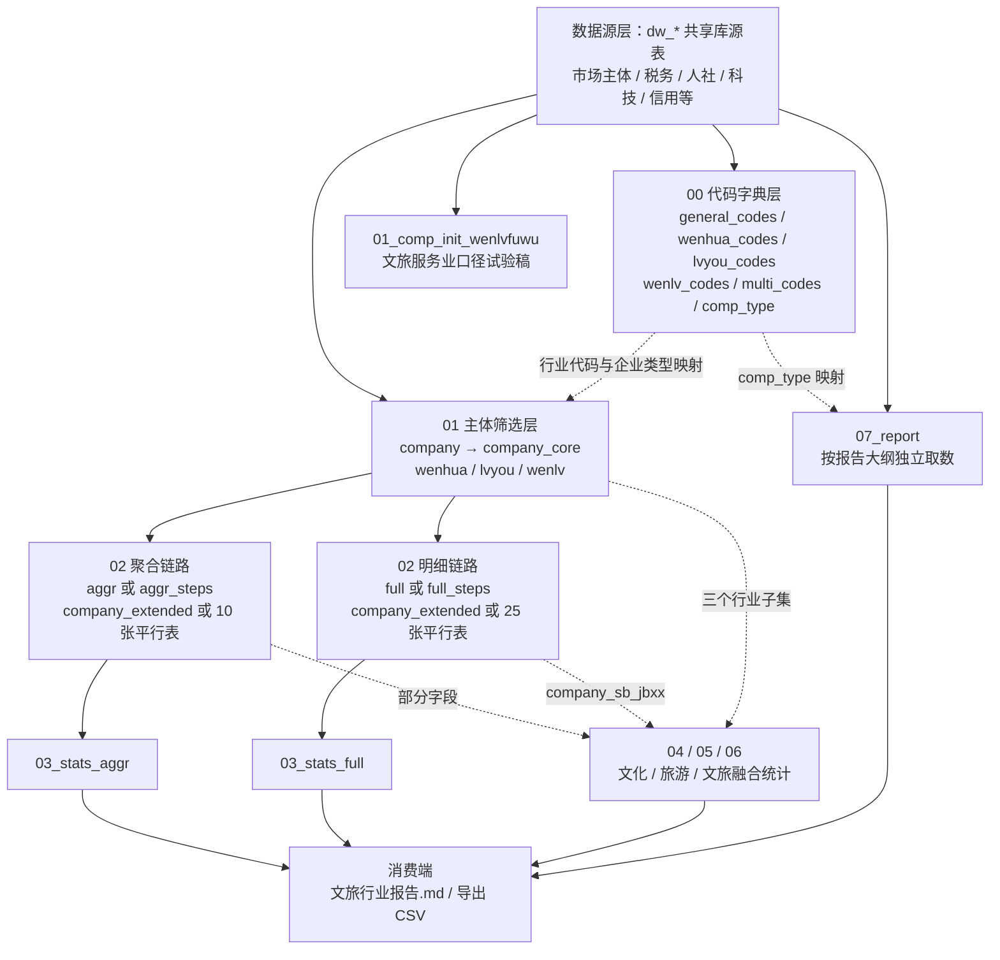

# src_cloud 代码功能架构说明

> 适用范围：`src_cloud/` 下的 14 个 SQL 脚本。
> 编写目的：项目跨年度延续时的代码导航，重点说明每个脚本做什么、彼此怎么衔接、同一编号下的多个文件是什么关系。
> 编写日期：2026 年 11 月 5 日。
> 参考材料：脚本自身注释、`columns.md`（源表数据字典）、`industry_codes/`（行业代码清单）、`report/文旅行业报告_2025-10-16.md`（报告大纲）。

---

## 一、项目定位与数据链路

这套 SQL 运行在云服务器内的 MySQL（政务数据共享库）上，源表是 `columns.md` 中登记的一批 `dw_*` 表，涵盖市场监管（SCJDGL）、税务（SW）、人社（RLSB）、科技（KJ）、发改（FZGG）、大数据信用（DSJ）、建设（JS）、交通（JT）等部门数据。所有表以统一社会信用代码 `uni_social_crd_cd` 为主关联键。

要解决的问题是：从全量市场主体库中识别宁波市文旅经营主体，把散落在各部门的企业属性挂到主体上，再按文化、旅游、文旅融合等口径产出统计指标，最终填入《宁波文旅经营主体发展 2025》报告。

完整链路分两端：

- 云端生产端：即 `src_cloud/`，直接查共享库，建中间表，跑统计查询，结果人工复制进报告。
- 本地复现端：`data/` 下的 98 个源表 CSV，`local_db/cul_comp_db.sql` 建本地库，`src_local/` 下六个脚本按同样思路在本地重跑。本报告不展开这一端。

脚本的共同形态是“一段建表 DDL + 若干段可单独执行的校验统计 SELECT”，不是存储过程，也没有调度器。去年实际使用方式应为在数据库客户端里分段选中执行，逐段查看结果，因此文件里保留了不少草稿式片段与注释，这是理解第八节所列问题清单的前提。

产出物是数据库中间表和查询结果，不直接生成文件。文件头注释还提示过云端账号可能不允许建永久表，此时可改用 `CREATE TEMPORARY TABLE`。

---

## 二、编号规则

文件名前缀的两位数字有两类含义，需要分开看。

**第一类，阶段顺序（00 → 07）。** 表示流水线上的依赖层次，后一阶段读前一阶段生成的表：

| 前缀 | 层次 | 作用 |
| --- | --- | --- |
| `00` | 代码字典层 | 建行业代码表和企业类型映射表 |
| `01` | 主体筛选层 | 从市场主体总表筛出文旅企业，并切分行业子集 |
| `02` | 维度扩展层 | 把各部门数据挂到企业上 |
| `03` | 全量统计层 | 对全部文旅企业出统计指标 |
| `04`—`06` | 分行业统计层 | 分别对文化、旅游、文旅融合企业出同一套指标 |
| `07` | 报告取数层 | 按报告大纲逐条取数 |
| `99` | 测试占位 | 空文件 |

**第二类，同层并列变体。** 同一前缀下的多个文件不是前后步骤，而是同一功能的不同实现或不同分析对象，选其一即可：

- `01` 两份：主筛选方案，以及一份文旅服务业口径的试验查询。
- `02` 四份：一个 2×2 矩阵。`aggr` 与 `full` 是数据粒度之别，`steps` 后缀与否是执行方式之别。

  |  | 单脚本一次建表 | 分步建中间表 |
  | --- | --- | --- |
  | 聚合版（一企业一行） | `02_comp_ext_aggr.sql` | `02_comp_ext_aggr_steps.sql` |
  | 全明细版（一企业可多行） | `02_comp_ext_full.sql` | `02_comp_ext_full_steps.sql` |

- `03` 两份：分别配套 `aggr_steps` 与 `full_steps` 产出的表，字段名互不通用。
- `04`、`05`、`06` 三份：同一统计模板的三个分析对象，彼此平行，都依赖 `01` 和 `02`。
- `07` 一份：自成体系，另用一套统计口径，与 `01` 的表名有冲突，详见 5.7 节。

**特别提示：** `steps` 不是“接着上一步继续加工”，而是把同一批扩展任务拆成可逐段校验的独立语句。分步版生成的各张 `company_*` 表是平行关系，每张都从 `company_core` 重新出发，不是链式累积。

---

## 三、分层架构图

---

## 四、文件清单速查

| 文件 | 定位 | 主要产出 | 依赖 | 状态 |
| --- | --- | --- | --- | --- |
| `00_indus_codes.sql` | 行业代码与企业类型字典 | 6 张维表 | 无 | 主链路，需修语法 |
| `01_comp_init.sql` | 文旅主体筛选与三分 | `company`、`company_core`、`wenhua`、`lvyou`、`wenlv` | 源表 | 主链路 |
| `01_comp_init_wenlvfuwu.sql` | 文旅服务业筛选查询 | 无落表 | 源表 | 口径试验稿 |
| `02_comp_ext_aggr.sql` | 聚合版单脚本扩展 | `company_extended` | `company` | 备选实现 |
| `02_comp_ext_aggr_steps.sql` | 聚合版分步扩展 | 10 张 `company_*` 表 | `company_core` | 主链路，`03_aggr` 配套 |
| `02_comp_ext_full.sql` | 明细版单脚本扩展 | `company_extended` | `company` | 备选实现 |
| `02_comp_ext_full_steps.sql` | 明细版分步扩展 | 25 张 `company_*` 表 | `company_core` | 主链路，`03_full` 配套 |
| `03_stats_aggr.sql` | 全量统计（聚合口径） | 6 组宽表结果 | `aggr_steps` 表 | 主链路 |
| `03_stats_full.sql` | 全量统计（明细口径） | 8 组宽表结果 | `full_steps` 表 | 主链路 |
| `04_stats_wenhua_aggr.sql` | 文化企业统计 | 8 组宽表结果 | `wenhua` + 扩展表 | 未完成项较多 |
| `05_stats_lvyou_aggr.sql` | 旅游企业统计 | 8 组宽表结果 | `lvyou` + 扩展表 | 混用两条链路 |
| `06_stats_wenlv_aggr.sql` | 文旅融合企业统计 | 8 组宽表结果 | `wenlv` + 扩展表 | 混用两条链路 |
| `07_report.sql` | 报告大纲逐条取数 | `wentiyu`、`wenlv`、`wenlv_shebao` 等 | 源表 + `comp_type` | 独立口径 |
| `99_stats_test.sql` | 测试占位 | 无 | 无 | 空文件 |

---

## 五、各脚本功能详解

### 5.1 `00_indus_codes.sql`：代码字典层

在云端库里建立六张维表，为后续所有筛选和分类提供口径依据。

- `general_codes`：文旅全量行业小类代码，约 300 个四位《国民经济行业分类》代码，与 `01_comp_init.sql` 里硬编码的 `IN` 清单一致。
- `wenhua_codes`、`lvyou_codes`、`wenlv_codes`：分别按《文化及相关产业分类 2018》、《旅游及相关产业分类 2018》以及文旅融合口径归集的三套代码清单，`01` 用它们切出三个行业子集。
- `multi_codes`：多维映射表，把国民经济行业的门类、大类、中类、小类映射到文化门类代码、文化小类代码、旅游小类代码，并用 `is_core`、`is_all_wh`、`is_new_wh`、`is_all_ly`、`TYPE`、`xinyetai`、`shengbiao` 等标志位标注分类属性。`TYPE` 取 `culture`、`tourism`、`culture_tourism` 三值，同一小类允许多行，例如 `2461`、`6432`、`7861` 等同时出现在文化和旅游口径下。这份数据与 `industry_codes/cross_type.csv` 同源，表头字段完全一致。
- `comp_type`：企业类型代码到类型名称、企业大类的映射，约 280 条，`07` 用它拆分公司制企业与个体工商户，并统计企业大类分布。

建表语句有一处需要修：四个单列代码表（`general_codes`、`wenhua_codes`、`lvyou_codes`、`wenlv_codes`）的最后一列后都留了多余逗号，MySQL 不接受；`TYPE` 又是潜在保留字，建议改名或统一加反引号。

需要留意的是，三套代码清单并非严格互斥，交叉代码会导致同一企业同时进入 `wenhua` 和 `lvyou`，因此三个子集的数量不能直接相加当作文旅总量。

### 5.2 `01_comp_init.sql`：主体筛选层（主入口）

这是整个分析链路的起点，分三步收窄数据范围。

1. **筛主体建 `company`。** 从市场主体总表 `dw_zj_scjdgl_scztxx` 取数，条件是“行业代码属于 300 个文旅小类清单”**且**“经营范围命中 30 个文旅关键词之一”，关键词包括文化、多媒体、游戏、动漫、数字出版、会展、广告、工艺美术、旅游、观光、旅行、体育、休闲、酒店等。保留约 20 个字段，含登记机关、企业类型、登记状态、统一社会信用代码、名称、住所、法定代表人、注册资本、经营范围、成立日期、行政区划、行业代码等，按信用代码排序。
2. **抽核心表 `company_core`。** 从 `company` 取 10 个最常用字段，作为全部扩展表、统计脚本的共同基准表。
3. **切行业子集。** 按 `wenhua_codes`、`lvyou_codes`、`wenlv_codes` 三份清单，从 `company_core` 分别生成 `wenhua`、`lvyou`、`wenlv`。

脚本尾部附一批检查语句：总量与行业、类型、区县去重计数，`DESCRIBE`，前 10 条样本，以及 `reg_state` 登记状态的取值分布与分组计数。

### 5.3 `01_comp_init_wenlvfuwu.sql`：文旅服务业口径试验稿

不建表，只输出一份 SELECT。条件是行业代码前两位落在 `61`、`62`、`80` 至 `82`、`86` 至 `90` 共十个大类，或代码属于指定的 20 个小类。这是与主方案并列的另一种筛选思路，用于探索“文旅服务业”边界，未进入主链路，文件末尾还留有一句未写完的聚合表达式。

### 5.4 `02_comp_ext_*.sql`：维度扩展层

四个脚本的共同目标是：以 `uni_social_crd_cd` 为键，把市场监管、税务、人社、科技、发改、信用、建设、交通等部门共二十余张源表的属性挂到文旅企业上，形成可统计的企业画像。差别在粒度和执行方式。

**`02_comp_ext_aggr.sql`（聚合版，单脚本）**
一条大 SQL 完成 14 路 `LEFT JOIN`，配合 `GROUP BY` 全部主体字段和二十余个相关子查询，一次性生成 `company_extended`，保证一个企业一行。覆盖法定代表人、经营异常、严重违法失信、网站网店、股权变更、年报资产、对外担保、科技型小微、失信被执行、纳税、信用分、A 级纳税人、社保、行政处罚等维度。取值策略是“记录次数用 `COUNT`，最新值用 `MAX`/`MIN` 或 `ORDER BY 日期 DESC LIMIT 1` 的标量子查询”。文件头注释给出了云端不允许建永久表时的临时表写法。局限是多张一对多表直接相乘，`COUNT()` 类字段会被笛卡尔积放大，不如分步版可靠。

**`02_comp_ext_aggr_steps.sql`（聚合版，分步）**
与上者目标相同，但按业务域拆成 10 段，每段基于 `company_core` 平行生成一张中间表：`company_fddb`、`company_jyyc`、`company_yzwf`、`company_wzwd`、`company_gqbg`、`company_nb`、`company_ns`、`company_xypj`、`company_sxr`、`company_xzcf`。技术做法是先在各源表内用 `ROW_NUMBER() OVER (PARTITION BY 信用代码 ORDER BY 日期 DESC)` 预聚合，再取 `rn = 1`，配合 `COALESCE` 把无记录企业的计数补零，从根上避免连乘膨胀。每段都有行数校验和样本预览，`company_nb` 段还带有 2019 年资产均值、`nb_year >= 2020` 等探索性统计。`03_stats_aggr.sql` 配套的就是这一组表。

**`02_comp_ext_full.sql`（全明细版，单脚本）**
同样是 14 路 `LEFT JOIN`，但不做 `GROUP BY`、不做去重，输出表名仍为 `company_extended`。保留全部原始明细字段，包括证件号、案号、证书号、执行法院、处罚结果等，一个企业可能对应多行。文件头有完整的 18 个表别名对照表，便于阅读字段来源；正文里留有多处 `2025-09-01` 的字段裁剪批注，说明去年做过一次源表字段核对。

**`02_comp_ext_full_steps.sql`（全明细版，分步）**
按六个业务域生成 25 张 `company_*` 明细扩展表，是四个脚本里覆盖面最广的一份：

| 业务域 | 生成的表 |
| --- | --- |
| 基础信息 | `company_fddb` |
| 信用监管 | `company_jyyc`、`company_yzwf`、`company_sxr`、`company_xypj`、`company_xzcf`、`company_xzxk` |
| 财税金融 | `company_nb`、`company_ns`、`company_xypj_a`、`company_sb`、`company_gjj`、`company_db` |
| 科技服务 | `company_gxjs`、`company_sjkj`、`company_kjxw`、`company_kjzx` |
| 社保就业 | `company_sb_cbrs`、`company_sb_jbxx`、`company_sb_rycb` |
| 经营活动 | `company_wzwd`、`company_gqbg`、`company_gdcz`、`company_cyjy`、`company_zzzs` |

其中行政许可、公积金、股东出资、餐饮经营许可、资质证书、高新技术企业、省级科技型中小企业等数据源是聚合版没有的。个别关联不用信用代码，例如 `company_gxjs` 用证书号 `hold_cert_cd` 关联，`company_sjkj`、`company_kjxw`、`company_kjzx` 用企业名称关联，匹配口径与信用代码关联不同，引用结果时要注意。每张表都以 `core.*` 打头并附覆盖情况统计（`COUNT(字段)` 判断有多少记录匹配到）。

**两条链路不可混跑。** 聚合版和明细版都输出 `company_extended`，且两套 `steps` 生成的 `company_jyyc`、`company_nb`、`company_xypj` 等表同名但字段完全不同，在同一库里先后执行会互相覆盖。

### 5.5 `03_stats_*.sql`：全量统计层

两份脚本都是若干段相互独立的 SELECT，每段输出“统计类别 + 一列指标”的单行宽表，便于把结果直接复制进报告。统计主题一致：

| 主题 | 主要指标 |
| --- | --- |
| 基础数据 | 企业总数、行业种类数、企业类型数、涉及区县数 |
| 企业家数 | 经营异常、严重违法失信、失信被执行、A 级纳税人、有网站网店、有行政处罚、有股权变更、有对外担保等企业数 |
| 经营状况 | 资产总额、营业收入、净利润、纳税总额的均值与合计 |
| 社保参与 | 参保企业数、参保率、各险种平均人数 |
| 变更活动 | 各类异常、违法、股权、失信、处罚记录数或人均记录数 |
| 信用状况 | A、B、C、D 级纳税人数量，A 级占比，信用评价覆盖率 |
| 成立时间分布 | 2020 年后、2015—2019、2010—2014、2010 年前四段企业数及占比（仅 `full` 版） |
| 行业分布 | 按行业小类的企业数与占比（仅 `full` 版，取前 20） |

`03_stats_aggr.sql` 读的是 `aggr_steps` 的聚合字段，例如 `jyyc_latest_reason`、`wzwd_url`、`latest_punish_doc`、`nb_opt_income_total`、`company_xypj.tax_credi_level`。`03_stats_full.sql` 读的是 `full_steps` 的明细字段，例如 `busexclist`、`web_id`、`admin_punish_doc`、`opt_income_total`、`company_xypj_a.tax_credi_level`，多数指标改用 `COUNT(DISTINCT uni_social_crd_cd)` 去重。两份脚本里写成 `0 AS 某指标` 的列，都是当年尚未实现的占位项，注释里标有“需要单独统计”。

### 5.6 `04`、`05`、`06`：分行业统计层

三份脚本是同一统计模板套到 `wenhua`、`lvyou`、`wenlv` 三个子集上，结构几乎逐段对应：基础数据、企业家数、经营状况、社保参与、变更活动、信用状况、成立时间分布、行业分布。做法是通过 `JOIN 子集表` 把扩展表中的记录限定在本行业范围内。

各自的差别：

- `04_stats_wenhua_aggr.sql`：行业分布按代码前两位归入新闻出版（`22`）、广播电视（`23`）、文化创作（`24`）、软件（`51`）、互联网（`52`）、研发（`71`）、专业服务（`72`）、教育（`86`）、卫生（`87`）、体育（`88`）、娱乐（`90`）等板块；社保参与段全部为 `0` 占位。
- `05_stats_lvyou_aggr.sql`、`06_stats_wenlv_aggr.sql`：行业分布改为按 `indv_nm` 分组降序排列；社保参与段改用 `company_sb_jbxx` 实算五险平均参保人数与参保率。

三份脚本都残留较多 `0` 占位和跨链路字段混用，属于当年未收尾的部分，详见第八节。

### 5.7 `07_report.sql`：报告取数层

这一份与前面 `01`—`06` 的口径体系相互独立，是照着 `report/文旅行业报告_2025-10-16.md` 的章节顺序逐条写的取数脚本，文件头注明基础数据来自 `01_comp_init.sql`、扩展数据来自 `02_comp_ext_aggr_steps.sql`，相关代码已粘贴进本文件。功能分四块。

**第一块，三套分类口径各自建表。**

- `wentiyu`：按《国民经济行业分类》“文化、体育和娱乐业”，即行业代码前两位为 `86` 至 `90`。用 `00` 建立的 `comp_type` 字典左连生成 `wentiyu_with_type`，统计企业大类、企业类型、登记状态分布；再按企业类型代码白名单拆出 `wentiyu_gongsi`，按代码 `0450`、`9500` 拆出 `wentiyu_geti`。
- `wenhua`：按《文化及相关产业分类 2018》，约 140 个小类直接纳入，另有 18 个小类需要经营范围佐证，佐证条件是命中 60 余个关键词（文化、出版、演出、艺术、博物馆、虚拟现实、著作权等）。
- `lvyou`：按《旅游及相关产业分类 2018》，用中类前缀、指定小类白名单、候选小类三层条件组合，候选部分同样要求经营范围命中 60 余个关键词（景区、旅行社、演艺、导游、客运、民宿、露营、门票、签证等）。

三套口径都分别统计了公司制企业数（代码白名单或 `LIKE '%公司%'`）与个体工商户数。

**第二块，文旅经营主体合并。** `wenlv_temp` 把 `wentiyu`、`wenhua`、`lvyou` 三表 `UNION ALL`，再用 `ROW_NUMBER()` 按信用代码去重生成 `wenlv`，即三口径并集。据此统计总量、公司制与个体户数、覆盖的行业小类数、企业数量最多的 10 个行业小类（分别按三套口径各出一份），以及按工商注册机关 `reg_org` 的地区分布。

**第三块，社会贡献专题。** 基于 `wenlv` 生成 `wenlv_shebao`（左连社保基本信息表，按缴费截止日期取最新一条，得到参保人数与缴费起止日期）和 `wenlv_ss`（左连纳税信息表，按统计日期取最新一条，得到税额与销售收入），用于分析五险参保人数、缴费连续性、税费贡献与就业规模。

**第四块，信用等级专题。** 基于 `wenlv` 生成 `wenlv_xypj`（按评定日期取最新纳税信用等级），计算有信用评价企业占比、A 级企业数量与占比，对应报告中的信用分分布特征与覆盖度章节。

**口径冲突要特别注意：** `07` 里的 `wenhua`、`lvyou`、`wenlv` 与 `01` 的同名表含义完全不同。`01` 是按代码清单切出的三个子集，`07` 的 `wenlv` 是三套分类口径的并集去重结果。而且 `07` 的几处 `CREATE TABLE` 没有配套 `DROP`，若与 `01` 在同一库里顺序执行，会直接报表已存在。

### 5.8 `99_stats_test.sql`

空文件，仅作为测试或临时脚本的编号占位。

---

## 六、三条链路与字段命名对照

理解这套代码最关键的一点，是去年实际形成了三条互不兼容的链路。

| 链路 | 组合 | 用途 |
| --- | --- | --- |
| A 聚合链路 | `01_comp_init` → `02_comp_ext_aggr_steps` → `03_stats_aggr` → `04/05/06` | 一企业一行的画像与统计宽表，多数脚本围绕它写 |
| B 明细链路 | `01_comp_init` → `02_comp_ext_full_steps` → `03_stats_full` | 保留原始明细，数据源覆盖最广 |
| C 报告链路 | `00`（`comp_type`）→ `07_report` | 直接按报告大纲出数，自成口径 |

A、B 两条链路的同名表字段对照如下，引用时一旦串链路就会报字段不存在或得到错误结果。

| 含义 | A 聚合链路 | B 明细链路 |
| --- | --- | --- |
| 经营异常 | `company_jyyc.jyyc_latest_reason`、`jyyc_count` | `company_jyyc.busexclist`、`inclu_dt` |
| 严重违法失信 | `company_yzwf.latest_serill_rea`、`yzwf_count` | `company_yzwf.ill_comp_id` |
| 失信被执行 | `company_sxr.latest_executed_nm`、`sxr_count` | `company_sxr.executed_nm` |
| 网站网店 | `company_wzwd.wzwd_url` | `company_wzwd.web_id` |
| 行政处罚 | `company_xzcf.latest_punish_doc` | `company_xzcf.admin_punish_doc` |
| 股权变更 | `company_gqbg.latest_gqbg_dt` | `company_gqbg.inv` |
| 年报财务 | `company_nb.nb_opt_income_total`、`nb_net_profit` | `company_nb.opt_income_total`、`annual_tax_total` |
| 纳税信用等级 | `company_xypj.tax_credi_level` | `company_xypj_a.tax_credi_level` |
| 社保五险 | 无对应表 | `company_sb_jbxx.pens_num` 等 |
| 对外担保 | 无对应表 | `company_db.creditor` |

---

## 七、今年复跑的推荐顺序

所有脚本都是人工分段执行，不是整文件批处理。执行前先确认云端账号是否允许 `CREATE TABLE`（`02_comp_ext_aggr.sql` 和 `02_comp_ext_full.sql` 的注释都提到过权限限制），并建议为不同链路使用不同库或在表名上加年份后缀，避免同名覆盖。

| 场景 | 依次执行 | 说明 |
| --- | --- | --- |
| 常规续跑（推荐） | `00` → `01_comp_init` → `02_comp_ext_aggr_steps` → `03_stats_aggr` → `04`、`05`、`06` | 先按第八节修掉 `04`—`06` 的字段混用 |
| 需要保留明细 | `00` → `01_comp_init` → `02_comp_ext_full_steps` → `03_stats_full` | 与 A 链路分库运行 |
| 只更新报告数字 | `00`（至少 `comp_type`）→ `07_report` | 单独跑，或先备份 `01` 的同名表 |
| 口径核对 | `01_comp_init_wenlvfuwu`、两个单脚本版 `02`、`99` | 备选方案与草稿，不入主流程 |

---

## 八、复跑前建议核对的问题

以下是通读代码时发现的、会影响执行或结果准确性的点，按性质分两组。它们与“脚本去年确实跑通过”并不矛盾，因为去年是分段选取有效片段执行的。

### 8.1 会直接报错或静默出错

| 文件 | 位置 | 现象 | 建议 |
| --- | --- | --- | --- |
| `00_indus_codes.sql` | 4 处单列代码表的 `CREATE TABLE` | 最后一列 `indv_nm VARCHAR(10),` 后多一个逗号，MySQL 不接受 | 删除尾随逗号；`TYPE` 建议改名或统一加反引号 |
| `00_indus_codes.sql` | `lvyou_codes` 插入段 | `8930` 重复出现两次 | 去重，避免代码表多行 |
| `01_comp_init.sql` | 结果统计段 | `COUNT(*) AS company` 后缺逗号 | 补逗号 |
| `01_comp_init.sql` | `company_core`、`lvyou`、`wenlv` 后 | `COUNT(*) ... FROM 表名;` 缺 `SELECT` | 补 `SELECT`，或执行时跳过这些校验片段 |
| `01_comp_init.sql` | `wenlv` 的 `IN` 清单 | 三行清单之间缺两处逗号，MySQL 会把相邻字面量静默拼接，例如 `7714` 与 `7715` 拼成 `77147715`，导致文旅融合企业几乎筛不到 | 补逗号，这是最隐蔽的一处 |
| `01_comp_init_wenlvfuwu.sql` | 文件末尾 | 孤立的 `COUNT(DISTINCT uni_social_crd_cd)` | 补完整查询或删除 |
| `03_stats_aggr.sql` | 基础数据段 | `COUNT(DISTINCT comp_type) AS company_type_count,` 后多一个逗号 | 删除尾随逗号 |
| `03_stats_aggr.sql` | 经营状况段 | 引用 `tax_amt`，但该段只查 `company_nb`，此表无该列 | 改为左连 `company_ns` 或删去该指标 |
| `03_stats_full.sql` | 信用状况段 | 写 `company_xypj.credi_scard`，实际该列在 `company_xypj_a`，`company_xypj` 里叫 `cred_scard` | 改表名或字段名 |
| `07_report.sql` | `wenhua`、`lvyou`、`wenlv_shebao` 等 | 多处 `CREATE TABLE` 未配 `DROP`，且与 `01` 同名 | 补 `DROP TABLE IF EXISTS`，或分库运行 |

### 8.2 口径与一致性需要确认

| 问题 | 说明 |
| --- | --- |
| `comp_type` 字段形态不统一 | `01` 的注释把 `comp_type` 写成中文企业类型，`07` 的 `wentiyu_gongsi` 用数字代码白名单，`wenhua`、`lvyou` 又用 `LIKE '%公司%'` 和 `= '个体工商户'`，`00` 的字典键是数字代码。同一字段存在两套假设，需先查源表实际取值再统一 |
| 字典与 CSV 不同步 | `multi_codes` 与 `industry_codes/cross_type.csv` 表头一致但内容已有差异，例如 `0141` 的旅游小类代码在 CSV 里是 `1426`，在 `00` 脚本里是空值。今年更新时应明确以哪份为准 |
| `04`—`06` 混用两条链路 | 经营状况、变更活动用 A 链路的聚合字段，社保参与却用只有 B 链路才有的 `company_sb_jbxx`；另有 `JOIN` 后不加去重或筛选条件，把“记录数”当成“企业数”统计 |
| 占位指标未实现 | 变更企业数、科技型小微企业数、有对外担保企业数、信用评价覆盖率、社保参与率等，在三份分行业脚本中仍写作 `0` |
| 聚合版单脚本的计数失真 | `02_comp_ext_aggr.sql` 把多张一对多表直接连乘后再 `COUNT`，次数类指标会被放大；`02_comp_ext_aggr_steps.sql` 用窗口函数预聚合，结果更可信，建议以后者为准 |
| 企业名称关联的风险 | `02_comp_ext_full_steps.sql` 中四张科技类扩展表用企业名称或证书号关联，重名、简称、更名都会影响匹配率，报告中引用这些指标需注明口径 |
| 项目文档已滞后 | `README.md` 最后更新于 2024 年，其中提到的 `bigfiles/`、`pyscripts/`、`resources/` 目录和 `01_ent.sql` 等文件名与当前仓库不一致，目录结构与脚本清单以本文件及 `src_cloud/` 实际内容为准 |
